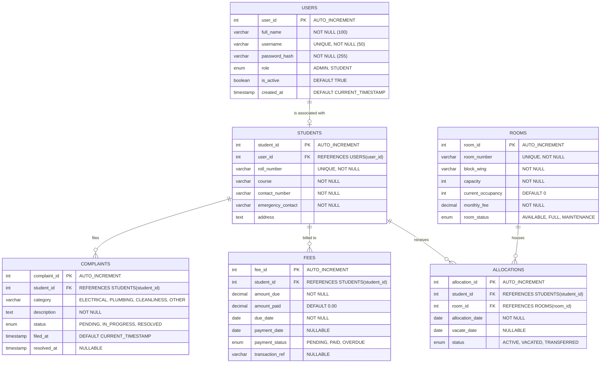
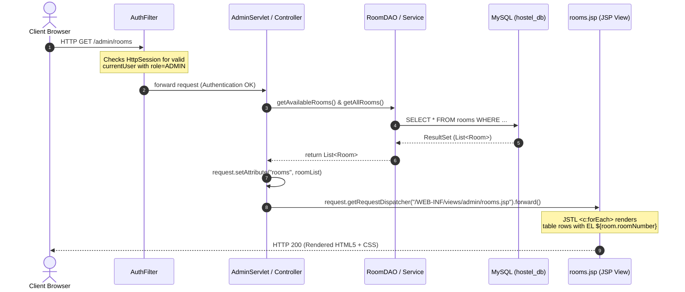

# 🏢 Student Hostel Management System (SHMS)

[](https://www.oracle.com/java/)
[](https://www.mysql.com/)
[]()
[]()
[]()
[]()
[]()

> A robust, role-based Java application designed to digitize, streamline, and secure hostel operations—including room allocations, student records, fee tracking, grievance handling, and automated reporting. Engineered across a complete 3-phase evolutionary roadmap from secure CLI/Swing desktop modules to an enterprise Web MVC architecture.

---

## 📌 Table of Contents
1. [Project Overview](#-project-overview)
2. [Problem Statement](#-problem-statement)
3. [Expected Outcomes](#-expected-outcomes)
4. [Alignment with UN Sustainable Development Goals (SDGs)](#-alignment-with-un-sustainable-development-goals-sdgs)
5. [Course Syllabus Alignment (Sections A, B, C, D)](#-course-syllabus-alignment)
6. [3-Phase Development Roadmap](#-3-phase-development-roadmap)
7. [Phase 1 Implementation Status (Completed)](#-phase-1-implementation-status-completed)
8. [Phase 2 Implementation Status (Completed)](#-phase-2-implementation-status-completed)
9. [Phase 3 Web Architecture & Implementation (Active)](#-phase-3-web-architecture--implementation-active)
   - [9.1 Architectural Overview: Desktop Swing to Web MVC](#91-architectural-overview-desktop-swing-to-web-mvc)
   - [9.2 Servlet Architecture & Lifecycle Mapping](#92-servlet-architecture--lifecycle-mapping)
   - [9.3 Request-Response Lifecycle & Session Management](#93-request-response-lifecycle--session-management)
   - [9.4 JSP Presentation Layer & Implicit Objects](#94-jsp-presentation-layer--implicit-objects)
   - [9.5 Web Security Filters & Role Authorization](#95-web-security-filters--role-authorization)
   - [9.6 Academic Viva & Theory Guide: Servlets/JSP vs. Spring Boot & Hibernate](#96-academic-viva--theory-guide-servletsjsp-vs-spring-boot--hibernate)
10. [System Architecture & Visual Diagrams](#-system-architecture--visual-diagrams)
    - [Diagram 1: Functional Decomposition Diagram (FDD)](#diagram-1-functional-decomposition-diagram-fdd)
    - [Diagram 2: UML Class Diagram](#diagram-2-uml-class-diagram)
    - [Diagram 3: Entity-Relationship (ER) Diagram](#diagram-3-entity-relationship-er-diagram)
    - [Diagram 4: Web MVC Request-Response Sequence Diagram](#diagram-4-web-mvc-request-response-sequence-diagram)
11. [Project Directory & Package Structure](#-project-directory--package-structure)
12. [Technologies & Tools Used](#-technologies--tools-used)
13. [Installation & Setup Guide](#-installation--setup-guide)
14. [Usage & Workflow](#-usage--workflow)
15. [Contributors & Acknowledgments](#-contributors--acknowledgments)

---

## 📖 Project Overview

The **Student Hostel Management System (SHMS)** is an end-to-end management solution developed to replace inefficient, paper-heavy, and error-prone hostel administration workflows. Built using core and advanced Java methodologies, the system provides separate, secure, role-based dashboards for **Hostel Wardens/Administrators** and **Hostel Residents (Students)**.

By centralizing data management and enforcing strict cryptographic security, SHMS ensures seamless room allocations, real-time tracking of room occupancy, transparent fee recording, structured grievance registration, and comprehensive administrative reporting.

---

## ❗ Problem Statement

Hostels in educational institutions frequently face administrative bottlenecks due to traditional record-keeping:
- **Manual Logbooks & Registers:** Student personal details, room allocations, and vacancy states are maintained in physical registers, leading to data loss, unauthorized access, and wear-and-tear.
- **Unoptimized Room Allocations:** Administrative staff struggle with room capacity management, duplicate bed assignments, and tracking vacant slots.
- **Opaque Fee Management:** Tracking pending dues, payment dates, and receipts via paper files often leads to accounting discrepancies and delayed audits.
- **Unresponsive Grievance Redressal:** Maintenance and facility complaints submitted verbally or in note slips often go untracked and unresolved.
- **Lack of Role-Based Security:** Sensitive student personal data is accessible to unauthorized personnel due to a lack of digital access controls and secure authentication.

**The Solution:** A secure, modular, 3-tier software architecture engineered in Java that establishes centralized digital records, authenticated role-based access control (RBAC), and automated workflow pipelines.

---

## 🎯 Expected Outcomes

- **Centralized Student & Hostel Records:** Eliminates physical registers with a single persistent MySQL database.
- **Efficient Room Allocation & Occupancy Management:** Real-time visibility into occupied, partially occupied, and vacant rooms with one-click bed allotment.
- **Role-Based Access & High-Grade Security:** Clear isolation between administrative privileges and student self-service functionalities, backed by salted PBKDF2 password cryptography.
- **Transparent Fee & Complaint Tracking:** Real-time fee clearance indicators, automated receipt logging, and a systematic status lifecycle for student complaints (`PENDING` ➔ `IN_PROGRESS` ➔ `RESOLVED`).
- **Automated Hostel Reports:** Instant generation of reports for audit inspections, occupancy status, student demographics, and pending dues.
- **Universal Multi-Platform Accessibility:** Transition from desktop-bound Windows software to a universal web browser interface accessible across laptops, tablets, and mobile devices.

---

## 🌐 Alignment with UN Sustainable Development Goals (SDGs)

This project directly contributes to the United Nations Sustainable Development Goals:

| Goal | Description & Project Alignment |
| :--- | :--- |
| **SDG 9: Industry, Innovation, and Infrastructure** | **Digitizing Infrastructure & Resilient Systems:** By transitioning manual legacy operations into an automated, secure Java database application, SHMS exemplifies modern technological infrastructure for academic institutions. It integrates enterprise security standards (PBKDF2 key derivation, modular architecture) to ensure digital reliability. |
| **SDG 16: Peace, Justice, and Strong Institutions** | **Transparency, Accountability & Fair Redressal:** Eliminates nepotism and human error in room allocation and fee accounting through immutable digital records. Introduces an accountable, timestamped complaint resolution mechanism that empowers students and holds hostel management accountable. |

---

## 🎓 Course Syllabus Alignment

The implementation of this project is structured to strictly reflect and apply each section of the **Advanced Java / Object-Oriented Software Development** university syllabus:

```
┌─────────────────────────────────────────────────────────────────────────────────────────────┐
│                               COURSE SYLLABUS MAPPING                                       │
├─────────────────────┬─────────────────────────────────┬─────────────────────────────────────┤
│ Syllabus Section    │ Core Concepts Covered           │ Project Implementation Details      │
├─────────────────────┼─────────────────────────────────┼─────────────────────────────────────┤
│ Section-A:          │ • OOP Principles                │ • Encapsulation in Model layer      │
│ Core Java &         │   (Encapsulation, Inheritance,  │   (`User`, `Student`, `Room`)       │
│ Collection          │   Polymorphism, Abstraction)    │ • In-memory caching and session     │
│ Framework           │ • Collections: List, Map, Set   │   state via `Session` singleton     │
│                     │ • Iterators & Enumeration       │ • Dynamic data feeds for UI lists   │
├─────────────────────┼─────────────────────────────────┼─────────────────────────────────────┤
│ Section-B:          │ • Swing Containers & Frames     │ • Custom GUI frames (`LoginFrame`,  │
│ GUI Development     │ • Layout Managers               │   `AdminDashboard`, `ModuleFrame`)  │
│                     │   (Border, GridBag, Grid)       │ • Delegation Event Model with       │
│                     │ • Swing Components & Dialogs    │   `ActionListener`, lambda handlers │
│                     │ • Event Dispatch Thread (EDT)   │ • `SwingUtilities.invokeLater()`    │
├─────────────────────┼─────────────────────────────────┼─────────────────────────────────────┤
│ Section-C:          │ • java.sql Architecture         │ • Persistent connection via         │
│ Database            │ • PreparedStatement & ResultSet │   `DBConnection` & JDBC MySQL Driver│
│ Connectivity &      │ • SQL Exception Handling        │ • SQL Injection prevention via      │
│ Networking          │ • Cryptographic Hashing         │   parameterized queries             │
│                     │ • Client-Server Networking      │ • Sockets & TCP/HTTP abstractions   │
├─────────────────────┼─────────────────────────────────┼─────────────────────────────────────┤
│ Section-D:          │ • Java Servlets: Lifecycle,     │ • Complete Phase 3 Web MVC app      │
│ Java Servlets,      │   Architecture, ServletConfig,  │ • AuthFilter, AuthServlet,          │
│ JSP & Frameworks    │   ServletContext, GenericServlet│   RoomServlet, AllocationServlet,   │
│                     │ • HttpServletRequest/Response,  │   FeeServlet, ComplaintServlet      │
│                     │   GET, POST, Session Management │ • HttpSession, Cookie authentication│
│                     │ • JavaServer Pages (JSP):       │ • JSP Directives, JSTL tags,        │
│                     │   Lifecycle, Implicit Objects,  │   EL expressions, Shared Data       │
│                     │   Directives, Actions           │ • Architectural comparison with     │
│                     │ • Spring, Spring Boot, Hibernate│   Spring Boot & Hibernate           │
└─────────────────────┴─────────────────────────────────┴─────────────────────────────────────┘
```

---

## 🚀 3-Phase Development Roadmap

The project is executed across three planned phases to achieve enterprise scalability:

```
┌─────────────────────────────────────────────────────────────────────────────────────────┐
│                                  PROJECT ROADMAP                                        │
└─────────────────────────────────────────────────────────────────────────────────────────┘
        │
        ├───► [PHASE 1] Core Authentication & Foundation (COMPLETED ✅)
        │     • MySQL Database & User Schema initialization
        │     • Industrial PBKDF2 password hashing & verification
        │     • Interactive Swing GUI with Event Delegation Model
        │     • Dynamic Role-Based Routing (Admin vs. Student)
        │     • Navigation wireframes matching Functional Decomposition Diagram
        │
        ├───► [PHASE 2] Full Desktop Business Logic & Data CRUD (COMPLETED ✅)
        │     • Multi-entity relational schema (Students, Rooms, Allocations, Fees, Complaints)
        │     • Data Access Object (DAO) layer implementation with transactional integrity
        │     • Interactive `JTable` views with search, sort, and filter features
        │     • Transactional workflows: Room Allocation, Fee Receipts, Complaint Updates
        │     • Automated analytical hostel reports (Demographics, Occupancy, Fees, Complaints)
        │
        └───► [PHASE 3] Enterprise Web Application Migration (ACTIVE / CURRENT 🌐)
              • Transition from Desktop Swing to Web MVC Architecture
              • Java Servlets (`HttpServlet`, `doGet`, `doPost`, `ServletConfig`, `ServletContext`)
              • Web Session tracking via `HttpSession` and security filters (`AuthFilter`)
              • JavaServer Pages (JSP) with Expression Language (EL), JSTL, and implicit objects
              • Professional, responsive UI built with standardized design tokens in `global.css`
              • Academic & Architectural mapping to Spring Boot and Hibernate ORM
```

---

## ✅ Phase 1 Implementation Status (Completed)

As of **Phase 1**, the complete foundational framework was engineered and verified:

1. **Database Connection Management (`DBConnection.java`):**
   - Implements a resilient connection factory using `java.sql.DriverManager`.
   - Targets local MySQL instance (`jdbc:mysql://localhost:3306/hostel_db`).
   - Handles connection exceptions cleanly.

2. **Enterprise-Grade Password Cryptography (`PasswordUtil.java`):**
   - Utilizes `PBKDF2WithHmacSHA256` key derivation.
   - Configured with **600,000 iterations**, a **256-bit derived key length**, and **16-byte cryptographically secure random salts** (`SecureRandom`).
   - Secure storage format (`<Base64 Salt>:<Base64 Hash>`) with constant-time equality checks (`MessageDigest.isEqual`) to eliminate timing-attack vulnerabilities.

3. **Autonomous Admin Bootstrapping CLI (`AdminSetup.java`):**
   - One-time secure command-line provisioning script for the initial administrative account.
   - Enforces strict password complexity (minimum 12 characters) and username format verification.
   - Guards against multiple admin initialization.

4. **Student Self-Registration Interface (`RegisterFrame.java`):**
   - User-friendly GUI with real-time field validation, password matching, and sanitization.
   - Automated detection and graceful handling of duplicate usernames (MySQL error code `1062` / SQLState `23000`).
   - Memory-safe credential handling using `char[]` clearing.

5. **Role-Based Authentication Engine (`LoginFrame.java` & `AuthService.java`):**
   - Authenticates credentials against the active user database.
   - Dynamically routes users based on their authorized role:
     - `ADMIN` ➔ Redirects to `AdminDashboard`
     - `STUDENT` ➔ Redirects to `StudentDashboard`

6. **State & Session Management (`Session.java` & `User.java`):**
   - Thread-safe in-memory session tracking for currently logged-in user details.
   - Complete session termination and memory flush on logout.

7. **Modular UI Skeleton (`AdminDashboard`, `StudentDashboard`, `ModuleFrame`, `UIUtils`):**
   - Intuitive Swing interfaces built with clean borders, cohesive color accents, and standard fonts.
   - Dynamic top banners displaying personalized user greetings (`Logged in as: <Name>`).
   - 100% synchronized with the **Functional Decomposition Diagram (FDD)**.

8. **Self-Service Password Management (`ChangePasswordDialog.java` & `AuthService.changePassword`):**
   - Completes the third branch of Authentication from the FDD (`Login`, `Logout`, `Change Password`).
   - Enforces password confirmation, old-password re-verification against stored PBKDF2 hash, and role-appropriate character length requirements.

---

## 🚀 Phase 2 Implementation Status (Completed)

In **Phase 2**, the complete desktop application and relational database operations were fully engineered:

1. **Relational Database Expansion (`phase2_schema.sql`):**
   - Implemented 5 relational tables (`students`, `rooms`, `allocations`, `fees`, `complaints`) with foreign key constraints, cascading deletions, and data integrity guarantees.
   - Seeded initial room configurations and sample accommodation records.

2. **Enterprise Data Access Object (DAO) Architecture:**
   - **`StudentDAO.java`**: Full student CRUD operations, multi-parameter search, and transactional user-student profile creation.
   - **`RoomDAO.java`**: Capacity tracking, available vs. occupied room querying, and safe room deletion guards.
   - **`AllocationDAO.java`**: Transactional room allotment, room transfer/change, and vacation logic that automatically updates live bed occupancy.
   - **`FeeDAO.java`**: Invoice generation, payment recording, balance calculations, and payment status transitions (`PENDING` ➔ `PAID`).
   - **`ComplaintDAO.java`**: Grievance registration, warden status tracking (`PENDING` ➔ `IN_PROGRESS` ➔ `RESOLVED`), and resolution remark logging.
   - **`ReportDAO.java`**: Multi-dimensional analytical querying for student demographics, room occupancy metrics, fee audits, and grievance summaries.

3. **Interactive Admin Control Panels:**
   - **`StudentManagementFrame.java`**: Real-time student search, tabular records, add/edit modal dialogues, and safe deletions.
   - **`RoomManagementFrame.java`**: Room inventory filtering (All / Available / Occupied), room addition, and capacity updates.
   - **`RoomAllocationFrame.java`**: Streamlined allotment dialog with auto-filtered unallocated students and vacant rooms, room transfer, and vacation handlers.
   - **`FeeManagementFrame.java`**: Invoice generation, partial/full payment recording with receipt reference tracking.
   - **`ComplaintManagementFrame.java`**: Complaint inbox for hostel wardens with live status updating and remark entry.
   - **`ReportsFrame.java`**: Tabbed analytics center rendering Student Demographics, Room Occupancy rates, Fee Auditing, and Complaint Redressal reports.

4. **Dedicated Student Resident Self-Service:**
   - **`StudentProfileFrame.java`**: View personal academic records and update contact/emergency phone numbers and address.
   - **`StudentRoomFrame.java`**: Real-time view of allocated room number, block, capacity, current roommates, and monthly fee.
   - **`StudentFeesFrame.java`**: Live status of fee invoices, payment receipts, and outstanding dues.
   - **`StudentComplaintsFrame.java`**: Form to submit maintenance grievances with category tags and track resolution statuses.

---

## 🌐 Phase 3 Web Architecture & Implementation (Active)

In **Phase 3**, the system transitions from desktop-bound Java Swing software into a universal **Web Application** powered by **Java Servlets, JavaServer Pages (JSP), and the Model-View-Controller (MVC)** architectural pattern, strictly fulfilling **Section D** of the Advanced Java university syllabus.

### 9.1 Architectural Overview: Desktop Swing to Web MVC

```
┌────────────────────────────────────────────────────────────────────────────────────────┐
│                                 PHASE 3 WEB MVC TOPOLOGY                               │
├────────────────────────────────────────────────────────────────────────────────────────┤
│                                                                                        │
│   [ Client Browser ]  (Chrome / Edge / Firefox / Mobile)                               │
│           │                                                                            │
│       HTTP Requests (GET, POST)                                                        │
│           ▼                                                                            │
│   ┌────────────────────────────────────────────────────────────────────────────────┐   │
│   │                          WEB CONTAINER (Apache Tomcat)                         │   │
│   │                                                                                │   │
│   │   [ Security Filter Layer ]                                                    │   │
│   │   • AuthFilter / LoggingFilter (Checks HttpSession, intercepts unauthorized)   │   │
│   │           │                                                                    │   │
│   │           ▼                                                                    │   │
│   │   [ Controller Layer (Java Servlets) ]                                         │   │
│   │   • AuthServlet        • AdminServlet         • StudentServlet                 │   │
│   │   • RoomServlet        • AllocationServlet    • FeeServlet                     │   │
│   │   • ComplaintServlet   • ReportServlet                                         │   │
│   │           │                                      │                             │   │
│   │      Calls Service/DAO                      Forwards Model                     │   │
│   │           │                                      │                             │   │
│   │           ▼                                      ▼                             │   │
│   │   [ Model & DAO Layer ]                  [ View Layer (JSP & JSTL) ]           │   │
│   │   • Reused Phase 2 DAOs                  • login.jsp, register.jsp             │   │
│   │   • Domain Entities                      • admin/dashboard.jsp, rooms.jsp      │   │
│   │   • DBConnection (JDBC)                  • student/dashboard.jsp, fees.jsp     │   │
│   │           │                              • global.css & script.js              │   │
│   │           ▼                                      │                             │   │
│   │   [ MySQL Database: hostel_db ]                  │                             │   │
│   │                                                  ▼                             │   │
│   │                                          Renders HTML5 Output                  │   │
│   └──────────────────────────────────────────────────┼─────────────────────────────┘   │
│                                                      ▼                                 │
│                                            HTTP Response (HTML/CSS)                    │
│                                                      ▼                                 │
│                                              [ Client Display ]                        │
└────────────────────────────────────────────────────────────────────────────────────────┘
```

---

### 9.2 Servlet Architecture & Lifecycle Mapping

Every servlet in Phase 3 extends `jakarta.servlet.http.HttpServlet` (or `javax.servlet.http.HttpServlet`) and implements the standard servlet lifecycle:

```
[Servlet Class Loaded] ➔ init(ServletConfig) ➔ service() [dispatches doGet/doPost] ➔ destroy()
```

1. **`init(ServletConfig config)`**: Executed once when the servlet is first initialized. Retrieves servlet-specific parameters via `ServletConfig` and global application context parameters via `ServletContext`.
2. **`service(HttpServletRequest req, HttpServletResponse resp)`**: Evaluates the HTTP request method and delegates to either `doGet()` or `doPost()`.
3. **`doGet(HttpServletRequest req, HttpServletResponse resp)`**: Handles idempotent read requests:
   - Rendering dashboard pages
   - Fetching room inventories and complaint lists
   - Displaying student profiles and fee summaries
4. **`doPost(HttpServletRequest req, HttpServletResponse resp)`**: Handles state-mutating transactions:
   - Form submission for login and registration
   - Room allocation and vacation operations
   - Recording fee payments and filing maintenance grievances
5. **`destroy()`**: Invoked by the web container prior to taking the servlet out of service, releasing database and I/O resources.

#### Servlet Configuration & Context Sharing:
- **`ServletConfig`**: Provides initialization parameters configured per servlet in `web.xml` (or via `@WebServlet(initParams = ...)`).
- **`ServletContext`**: Shared application-wide context (`getServletContext()`) used for sharing global resources (database connection pool references, application-level settings) across all servlets.

---

### 9.3 Request-Response Lifecycle & Session Management

- **Request Parsing (`HttpServletRequest`):**
  - Form field extraction using `request.getParameter("paramName")`.
  - Request attribute binding for views using `request.setAttribute("attributeName", object)`.
  - Reading client headers, cookies, and HTTP methods.
- **Response Dispatching (`HttpServletResponse`):**
  - View forwarding: `request.getRequestDispatcher("/WEB-INF/views/dashboard.jsp").forward(request, response)`.
  - Client-side redirect: `response.sendRedirect(request.getContextPath() + "/login?error=auth")`.
- **Session Tracking (`HttpSession`):**
  - Replaces the desktop in-memory singleton ([Session.java](file:///c:/Harshit/mruLABS/studentHostelManagementSystem/src/com/hostelmanagement/session/Session.java)).
  - Sessions are tracked per browser using the standard `JSESSIONID` cookie.
  - User session creation on valid login:
    ```java
    HttpSession session = request.getSession(true);
    session.setAttribute("currentUser", authenticatedUser);
    session.setAttribute("userRole", authenticatedUser.getRole());
    ```
  - Invalidation on logout: `session.invalidate()`.

---

### 9.4 JSP Presentation Layer & Implicit Objects

JavaServer Pages (JSP) serve as the **View** tier, rendering dynamic HTML while encapsulating business logic strictly in the Servlets.

#### JSP Implicit Objects Utilized in SHMS:
- **`request`** (`HttpServletRequest`): Accesses request attributes passed from Servlets (e.g., student lists, room lists).
- **`response`** (`HttpServletResponse`): Modifies response headers or content types.
- **`session`** (`HttpSession`): Reads logged-in user credentials and active role.
- **`application`** (`ServletContext`): Accesses application-scope parameters.
- **`out`** (`JspWriter`): Outputs content to the response stream.
- **`pageContext`** (`PageContext`): Manages page-scope variables and tag handler environments.

#### JSP Syntax, Directives & JSTL Tags:
- **Directives:** Page directives for imports and encoding (`<%@ page contentType="text/html;charset=UTF-8" language="java" %>`).
- **JSTL Core Tags (`c:forEach`, `c:if`, `c:choose`):**
  - Iterating over lists without scriptlets:
    ```jsp
    <c:forEach var="room" items="${roomList}">
        <tr>
            <td>${room.roomNumber}</td>
            <td>${room.blockWing}</td>
            <td><span class="badge ${room.roomStatus}">${room.roomStatus}</span></td>
        </tr>
    </c:forEach>
    ```
- **Expression Language (EL):** Clean data retrieval syntax (`${currentUser.fullName}`, `${student.rollNumber}`).

---

### 9.5 Web Security Filters & Role Authorization

To prevent unauthorized direct URL access (e.g., a student typing `/admin/rooms` into the browser bar), an **`AuthFilter`** implementing `jakarta.servlet.Filter` guards protected routes:

```java
// Logic inside AuthFilter.doFilter()
HttpSession session = httpRequest.getSession(false);
User user = (session != null) ? (User) session.getAttribute("currentUser") : null;

if (user == null && isProtectedPath(requestURI)) {
    httpResponse.sendRedirect(httpRequest.getContextPath() + "/login");
} else if (requestURI.startsWith("/admin") && !"ADMIN".equals(user.getRole())) {
    httpResponse.sendError(HttpServletResponse.SC_FORBIDDEN, "Access Denied: Admin Privileges Required");
} else {
    chain.doFilter(request, response);
}
```

---

### 9.6 Academic Viva & Theory Guide: Servlets/JSP vs. Spring Boot & Hibernate

In university academic evaluations and lab vivas, students are frequently asked about the theoretical and architectural relationship between traditional Servlets/JSP and modern enterprise frameworks:

```
┌─────────────────────────────────────────────────────────────────────────────────────────────────┐
│                    EVOLUTIONARY COMPARISON: SERVLETS/JSP vs. MODERN FRAMEWORKS                  │
├─────────────────────┬─────────────────────────────────────┬─────────────────────────────────────┤
│ Dimension           │ Traditional: Servlets & JSP (SHMS)  │ Modern: Spring Boot & Hibernate     │
├─────────────────────┼─────────────────────────────────────┼─────────────────────────────────────┤
│ Architecture        │ Explicit MVC with `HttpServlet`,    │ Declarative MVC with `@Controller`, │
│                     │ manual `doGet`/`doPost` routing     │ `@RestController`, `@GetMapping`    │
├─────────────────────┼─────────────────────────────────────┼─────────────────────────────────────┤
│ Core Engine         │ Direct execution on Servlet API     │ `DispatcherServlet` internally      │
│                     │ container (Tomcat)                  │ delegates to controller beans       │
├─────────────────────┼─────────────────────────────────────┼─────────────────────────────────────┤
│ Persistence         │ Direct JDBC via `PreparedStatement` │ Object-Relational Mapping (ORM) via │
│                     │ and manual DAO result set mapping   │ Hibernate `@Entity` & Spring Data   │
├─────────────────────┼─────────────────────────────────────┼─────────────────────────────────────┤
│ Server Model        │ Deployed to Web Container / Server  │ Embedded Tomcat bundled inside JAR  │
├─────────────────────┼─────────────────────────────────────┼─────────────────────────────────────┤
│ Academic Benefit    │ Transparent: Every HTTP lifecycle   │ High abstraction: Core web concepts │
│                     │ stage is visible in source code     │ are hidden behind annotations       │
└─────────────────────┴─────────────────────────────────────┴─────────────────────────────────────┘
```

> **Viva Insight:** *"Spring Boot does not replace Java Servlets—it builds on top of them. Spring's `DispatcherServlet` is an `HttpServlet` that handles front-controller routing. Understanding Servlets and JSP gives the exact foundational understanding of how web requests, headers, and sessions work before Spring abstracts them with annotations."*

---

## 📊 System Architecture & Visual Diagrams

### Diagram 1: Functional Decomposition Diagram (FDD)
*Represents the hierarchical breakdown of the system functions and role-based permissions.*

```mermaid
graph TD
    Root["Student Hostel Management System"]
    
    Auth["Authentication"]
    Admin["Admin / Warden Dashboard<br/>(Full Access)"]
    Student["Student Dashboard<br/>(Own Data Only)"]
    
    Root --> Auth
    Root --> Admin
    Root --> Student
    
    %% Auth Functions
    Auth --> F_Login["Login"]
    Auth --> F_Logout["Logout"]
    Auth --> F_CPass["Change Password"]
    
    %% Admin Modules
    Admin --> M_SM["Student Management"]
    Admin --> M_RM["Room Management"]
    Admin --> M_RA["Room Allocation"]
    Admin --> M_FM["Fee Management"]
    Admin --> M_CM["Complaint Management"]
    Admin --> M_REP["Reports"]
    
    %% Admin Functions
    M_SM --> F_AddS["Add Student"]
    M_SM --> F_ViewS["View Student"]
    M_SM --> F_SearchS["Search Student"]
    M_SM --> F_UpdS["Update Student"]
    M_SM --> F_DelS["Delete Student"]
    
    M_RM --> F_ViewR["View Room"]
    M_RM --> F_AddR["Add Room"]
    M_RM --> F_UpdR["Update Room"]
    M_RM --> F_DelR["Delete Room"]
    M_RM --> F_AvailR["View Available Rooms"]
    M_RM --> F_OccR["View Occupied Rooms"]
    
    M_RA --> F_AllocR["Allocate Room"]
    M_RA --> F_ChgR["Change Room"]
    M_RA --> F_VacR["Vacate Room"]
    M_RA --> F_ViewAlloc["View Allocation"]
    
    M_FM --> F_RecFee["Record Fee"]
    M_FM --> F_ViewFee["View Fee"]
    M_FM --> F_PendFee["View Pending Fees"]
    M_FM --> F_RecPay["Record Payment"]
    M_FM --> F_UpdPay["Update Payment Status"]
    
    M_CM --> F_ViewC["View Complaints"]
    M_CM --> F_ViewCDet["View Complaint Details"]
    M_CM --> F_UpdCStat["Update Status"]
    M_CM --> F_ResC["Resolve Complaint"]
    
    M_REP --> F_SReport["Student Report"]
    M_REP --> F_RReport["Room Report"]
    M_REP --> F_FReport["Fee Report"]
    M_REP --> F_OReport["Occupancy Report"]
    M_REP --> F_CReport["Complaint Report"]
    
    %% Student Modules & Functions
    Student --> M_SProf["Profile"]
    Student --> M_SRoom["Room Details"]
    Student --> M_SFees["Fees"]
    Student --> M_SComp["My Complaints"]
    
    M_SProf --> F_SViewP["View Profile"]
    M_SProf --> F_SUpdP["Update Profile"]
    
    M_SRoom --> F_SViewR["View Allocated Room"]
    
    M_SFees --> F_SViewFee["View Fee Details"]
    M_SFees --> F_SViewPStat["View Payment Status"]
    
    M_SComp --> F_SSubC["Submit Complaint"]
    M_SComp --> F_SViewMC["View My Complaints"]
```



---

### Diagram 2: UML Class Diagram
*A comprehensive, hierarchical 3-tier UML Class Diagram covering all functional modules (Students, Rooms, Allocations, Fees, Complaints, Reports, and Security) structured top-to-bottom without visual clutter.*

```mermaid
classDiagram
    direction TB

    %% ==========================================
    %% TIER 1: PRESENTATION LAYER (GUI & WEB)
    %% ==========================================
    class LoginFrame {
        -JTextField usernameField
        -JPasswordField passwordField
        +performLogin()
        +openRegister()
    }

    class AdminDashboard {
        +openStudentManagement()
        +openRoomManagement()
        +openRoomAllocation()
        +openFeeManagement()
        +openComplaintManagement()
        +openReports()
        +logout()
    }

    class StudentDashboard {
        +openProfile()
        +openRoomDetails()
        +openFees()
        +openComplaints()
        +logout()
    }

    class AuthServlet {
        +doGet(req, resp)
        +doPost(req, resp)
    }

    class AdminServlet {
        +doGet(req, resp)
        +doPost(req, resp)
    }

    class StudentServlet {
        +doGet(req, resp)
        +doPost(req, resp)
    }

    class AuthFilter {
        +doFilter(req, resp, chain)
    }

    %% ==========================================
    %% TIER 2: BUSINESS SERVICES & DAOs
    %% ==========================================
    class AuthService {
        +login(username, password) User
        +registerStudent(name, username, password) boolean
        +changePassword(userId, oldPass, newPass) boolean
    }

    class StudentDAO {
        +getAllStudents() List~Student~
        +getStudentById(int id) Student
        +addStudent(Student) boolean
        +updateStudent(Student) boolean
        +deleteStudent(int id) boolean
    }

    class RoomDAO {
        +getAllRooms() List~Room~
        +getAvailableRooms() List~Room~
        +addRoom(Room) boolean
        +updateRoom(Room) boolean
    }

    class AllocationDAO {
        +allocateRoom(studentId, roomId) boolean
        +vacateRoom(allocationId) boolean
        +getActiveAllocations() List~Allocation~
    }

    class FeeDAO {
        +getFeesByStudent(studentId) List~Fee~
        +recordPayment(feeId, amount) boolean
        +getPendingFees() List~Fee~
    }

    class ComplaintDAO {
        +submitComplaint(Complaint) boolean
        +updateStatus(complaintId, status, remarks) boolean
        +getAllComplaints() List~Complaint~
    }

    class ReportDAO {
        +getOccupancyStats() Map
        +getFeeCollectionStats() Map
    }

    %% ==========================================
    %% TIER 3: DOMAIN ENTITIES & PERSISTENCE
    %% ==========================================
    class User {
        -int userId
        -String fullName
        -String username
        -String role
        +getRole() String
    }

    class Student {
        -int studentId
        -String rollNumber
        -String course
        -String contactNumber
        +getRollNumber() String
    }

    class Room {
        -int roomId
        -String roomNumber
        -int capacity
        -int currentOccupancy
        -String roomStatus
    }

    class Allocation {
        -int allocationId
        -int studentId
        -int roomId
        -Date allocationDate
        -String status
    }

    class Fee {
        -int feeId
        -int studentId
        -double amountDue
        -double amountPaid
        -String paymentStatus
    }

    class Complaint {
        -int complaintId
        -int studentId
        -String category
        -String description
        -String status
    }

    class DBConnection {
        +getConnection() Connection
    }

    %% Associations
    AuthServlet ..> AuthService : invokes
    AdminServlet ..> RoomDAO : uses
    AdminServlet ..> AllocationDAO : uses
    AdminServlet ..> FeeDAO : uses
    StudentServlet ..> ComplaintDAO : uses
    StudentServlet ..> StudentDAO : uses

    StudentDAO ..> DBConnection : queries
    RoomDAO ..> DBConnection : queries
    AllocationDAO ..> DBConnection : queries
    FeeDAO ..> DBConnection : queries
    ComplaintDAO ..> DBConnection : queries

    User <|-- Student : extends
    Student "1" --> "*" Allocation : receives
    Room "1" --> "*" Allocation : assigned to
    Student "1" --> "*" Fee : pays
    Student "1" --> "*" Complaint : files
```



---

### Diagram 3: Entity-Relationship (ER) Diagram
*Depicts the database schema, including the implemented `users` table and Phase 2 relational extensions.*



---

### Diagram 4: Web MVC Request-Response Sequence Diagram
*Illustrates the runtime interaction between Browser, AuthFilter, Controller Servlet, DAO/Service, Database, and JSP View.*



---

## 📁 Project Directory & Package Structure

```
studentHostelManagementSystem/
│
├── .classpath                          # Eclipse IDE classpath configuration
├── .project                            # Eclipse project metadata
├── .settings/                          # IDE project settings
├── README.md                           # Comprehensive project documentation
│
├── MySQL Database/                     # Database Definition & SQL Scripts
│   ├── users.sql                       # Phase 1 DDL: Database & Authentication Table
│   └── phase2_schema.sql               # Phase 2 DDL: Students, Rooms, Allocations, Fees, Complaints
│
├── src/                                # Java Source Code
│   │
│   ├── module-info.java                # Java Module System Descriptor (`java.desktop`, `java.sql`)
│   │
│   └── com/hostelmanagement/
│       ├── Main.java                   # Desktop Application Entrypoint (Swing EDT)
│       │
│       ├── auth/                       # Security & Authentication Layer
│       │   ├── AdminSetup.java         # CLI Utility to bootstrap initial Administrator
│       │   ├── AuthService.java        # Authentication business logic & SQL executions
│       │   └── PasswordUtil.java       # Industrial PBKDF2-HMAC-SHA256 password security
│       │
│       ├── dao/                        # Data Access Object (DAO) Persistence Layer
│       │   ├── AllocationDAO.java      # Room allocation, transfer, and vacate operations
│       │   ├── ComplaintDAO.java       # Student grievance filing and status updates
│       │   ├── FeeDAO.java             # Fee billing, payment tracking, and receipt logs
│       │   ├── ReportDAO.java          # Analytics, statistics, and audit report generation
│       │   ├── RoomDAO.java            # Room inventory, capacity, and status queries
│       │   └── StudentDAO.java         # Student profiles, CRUD, and search filters
│       │
│       ├── database/                   # Database Connectivity Layer
│       │   └── DBConnection.java       # JDBC Connection Factory for MySQL
│       │
│       ├── model/                      # Data Transfer Objects & Domain Models
│       │   ├── Allocation.java         # Room allotment entity
│       │   ├── Complaint.java          # Maintenance request entity
│       │   ├── Fee.java                # Fee invoice and payment transaction entity
│       │   ├── Room.java               # Hostel room and bed capacity entity
│       │   ├── Student.java            # Student resident profile entity
│       │   └── User.java               # Immutable representation of an authenticated user
│       │
│       ├── session/                    # Desktop In-Memory Session Management
│       │   └── Session.java            # Thread-safe user session context holder (Swing)
│       │
│       ├── ui/                         # Desktop Presentation Layer (Java Swing GUI)
│       │   ├── AdminDashboard.java     # Warden & Admin control panel
│       │   ├── ChangePasswordDialog.java # Self-service password update modal
│       │   ├── ComplaintManagementFrame.java # Admin complaint resolution dashboard
│       │   ├── FeeManagementFrame.java # Admin fee invoice and payment tracker
│       │   ├── LoginFrame.java         # User login screen with role redirection
│       │   ├── ModuleFrame.java        # Modular container for sub-functional workflows
│       │   ├── RegisterFrame.java      # Student self-registration window
│       │   ├── ReportsFrame.java       # Tabbed administrative reporting center
│       │   ├── RoomAllocationFrame.java# Bed allotment, transfer, and vacate console
│       │   ├── RoomManagementFrame.java# Room inventory and capacity management
│       │   ├── StudentComplaintsFrame.java # Student grievance submission and tracking
│       │   ├── StudentDashboard.java   # Student resident self-service dashboard
│       │   ├── StudentFeesFrame.java   # Student fee dues and payment receipts view
│       │   ├── StudentManagementFrame.java # Admin student directory and CRUD console
│       │   ├── StudentProfileFrame.java# Student profile view and contact updater
│       │   └── StudentRoomFrame.java   # Student allocated room and roommate details
│       │
│       ├── util/                       # Reusable UI & Application Utilities
│       │   └── UIUtils.java            # Standardized button styling, table renderer, dialogs
│       │
│       └── web/                        # Phase 3 Web Layer (Servlets, Filters, Listeners)
│           ├── filter/                 # Web Security & Authentication Filters
│           │   ├── AuthFilter.java     # Role-based route guard for /admin/* and /student/*
│           │   └── EncodingFilter.java # UTF-8 Character encoding filter
│           │
│           ├── listener/               # Application Lifecycle Listeners
│           │   └── AppContextListener.java # Global ServletContext initialization
│           │
│           └── servlet/                # Web Controllers (HTTP Request Handlers)
│               ├── AuthServlet.java    # /login, /register, /logout, /change-password
│               ├── AdminServlet.java   # /admin/dashboard, /admin/analytics
│               ├── StudentServlet.java # /student/dashboard, /student/profile
│               ├── RoomServlet.java    # /admin/rooms (CRUD, status filter)
│               ├── AllocationServlet.java # /admin/allocations (allot, transfer, vacate)
│               ├── FeeServlet.java     # /admin/fees & /student/fees
│               ├── ComplaintServlet.java # /admin/complaints & /student/complaints
│               └── ReportServlet.java  # /admin/reports (Occupancy, dues, demographics)
│
├── webcontent/                         # Web Application Root Directory
│   ├── index.jsp                       # Root landing page (redirects to login)
│   ├── css/
│   │   └── global.css                  # Standardized color tokens, light/dark themes
│   ├── js/
│   │   └── main.js                     # Client-side validation, modals, dynamic filters
│   │
│   └── WEB-INF/                        # Secure Private Web Resources
│       ├── web.xml                     # Web Application Deployment Descriptor
│       └── views/                      # Protected JSP Templates (Not directly accessible via URL)
│           ├── common/
│           │   ├── header.jsp          # Reusable header with user banner & navigation
│           │   └── footer.jsp          # Standardized footer & script imports
│           ├── auth/
│           │   ├── login.jsp           # Web Login interface
│           │   ├── register.jsp        # Student registration form
│           │   └── change-password.jsp # Password update modal/view
│           ├── admin/
│           │   ├── dashboard.jsp       # Warden overview with metric cards
│           │   ├── students.jsp        # Searchable student directory table
│           │   ├── rooms.jsp           # Room management & occupancy cards
│           │   ├── allocations.jsp     # Bed assignment & vacation console
│           │   ├── fees.jsp            # Fee invoice ledger & payment recorder
│           │   ├── complaints.jsp      # Grievance inbox with status updater
│           │   └── reports.jsp         # Visual analytical report tables
│           └── student/
│               ├── dashboard.jsp       # Student personal overview
│               ├── profile.jsp         # Academic & contact details view/edit
│               ├── room.jsp            # Allocated room details & roommates
│               ├── fees.jsp            # Fee dues & payment receipts ledger
│               └── complaints.jsp      # Complaint submission & tracking
│
└── bin/                                # Compiled Bytecode (.class files, ignored by Git)
```

---

## 🛠 Technologies & Tools Used

- **Programming Language:** Java 21 (LTS) & Java 25
- **Web Technologies:**
  - **Servlet API:** Java Servlets (`jakarta.servlet` / `javax.servlet`, `HttpServlet`, `HttpServletRequest`, `HttpServletResponse`, `ServletConfig`, `ServletContext`)
  - **Server-Side Templating:** JavaServer Pages (JSP), JavaServer Pages Standard Tag Library (JSTL Core, Format), Expression Language (EL)
  - **Web Security:** `jakarta.servlet.Filter` (`AuthFilter`) with `HttpSession` cookie tracking
- **Graphical User Interface (GUI - Desktop):** Java Swing & AWT (`BorderLayout`, `GridBagLayout`, `GridLayout`)
- **Web Styling & Frontend:** HTML5, CSS3 with unified design tokens (`global.css`), Vanilla JavaScript (ES6)
- **Database:** MySQL 8.0+
- **Database Driver:** MySQL Connector/J (`mysql-connector-j-9.x.jar`)
- **Cryptography / Hashing:** `PBKDF2WithHmacSHA256` (Java Cryptography Extension)
- **Application Server / Container:** Apache Tomcat (Embedded / Standalone)
- **Build / IDE:** Eclipse IDE / Antigravity CLI / Visual Studio Code
- **Version Control:** Git & GitHub

---

## ⚙️ Installation & Setup Guide

### 1. Prerequisites
- **Java Development Kit (JDK 21 or higher)** installed and verified:
  ```bash
  java -version
  javac -version
  ```
- **MySQL Server (v8.0 or higher)** running on `localhost:3306`.
- **MySQL Connector/J JAR** placed in the classpath / `WEB-INF/lib/`.
- **Apache Tomcat 10+** (or embedded runner).

---

### 2. Database Initialization
1. Open MySQL Command Line Client or MySQL Workbench:
   ```bash
   mysql -u root -p
   ```
2. Execute the initialization scripts in sequence:
   - Run `MySQL Database/users.sql` to initialize `hostel_db` and the `users` table.
   - Run `MySQL Database/phase2_schema.sql` to create `students`, `rooms`, `allocations`, `fees`, and `complaints` tables.

---

### 3. Database Credentials Configuration
Open [DBConnection.java](file:///c:/Harshit/mruLABS/studentHostelManagementSystem/src/com/hostelmanagement/database/DBConnection.java) and verify your local credentials:
```java
private static final String URL = "jdbc:mysql://localhost:3306/hostel_db";
private static final String DB_USER = "root";
private static final String DB_PASSWORD = "your_mysql_password"; // Set your local password
```

---

### 4. Create the First Admin Account
Before launching either the desktop or web interface, provision the root Administrator account using the command-line utility:
- Execute `com.hostelmanagement.auth.AdminSetup`:
  ```bash
  # Inside your IDE: Run com.hostelmanagement.auth.AdminSetup
  ```
- Enter your admin credentials interactively:
  ```text
  Admin full name: Chief Warden
  Admin username: admin
  Admin password (minimum 12 characters): AdminPass@1234
  >> Admin account created successfully.
  ```

---

### 5. Running the Application

#### Option A: Running the Web Application (Phase 3 - Recommended)
1. Deploy the project folder to Apache Tomcat, or run using your IDE's web server configuration.
2. Open your web browser and navigate to:
   ```
   http://localhost:8080/studentHostelManagementSystem/
   ```
3. The responsive Web Login page will appear.

#### Option B: Running the Desktop Application (Phase 1 & 2)
1. Execute `com.hostelmanagement.Main`.
2. The Swing desktop `LoginFrame` will appear.

---

## 🖥 Usage & Workflow

### 1. Student Registration
- Open the web application and click **"Register as Student"**.
- Provide Full Name, Username, and Password (min 8 characters).
- Upon submission, `AuthServlet` validates input, hashes the password with PBKDF2, saves the record via `AuthService`, and redirects to login with a success notice.

### 2. Role-Based Navigation
- **Logging in as Student:**
  - Authenticated and session assigned: `session.setAttribute("userRole", "STUDENT")`.
  - Routes directly to `/student/dashboard`.
  - Accessible modules: View Allocated Room details, Check Monthly Fees and Receipts, Submit Maintenance Complaints, and Update Profile.
- **Logging in as Admin / Warden:**
  - Authenticated and session assigned: `session.setAttribute("userRole", "ADMIN")`.
  - Routes directly to `/admin/dashboard`.
  - Full administrative access: Manage Student Directory, Configure Rooms & Bed Capacities, Allot & Vacate Rooms, Record Fee Payments, Resolve Complaints, and Generate Real-Time Analytical Reports.

### 3. Secure Session Termination
- Click **"Logout"** on the navigation banner.
- The servlet invokes `session.invalidate()` to completely destroy the `HttpSession` and clears browser cookies, redirecting securely back to `/login`.

---

## 👥 Contributors & Acknowledgments

- **Developed By:** Harshit Singhal
- **Academic Program:** Bachelor of Technology (Computer Science & Engineering) / Advanced Java Lab
- **Course Alignment:** Advanced Java Programming:
  - Section-A: Core OOP, Encapsulation, Collections
  - Section-B: Swing GUI, Event Delegation Model
  - Section-C: JDBC `java.sql` Architecture, Security Hashing
  - Section-D: Java Servlets, JSP, JSTL, Web MVC, and Enterprise Frameworks (Spring Boot / Hibernate)
