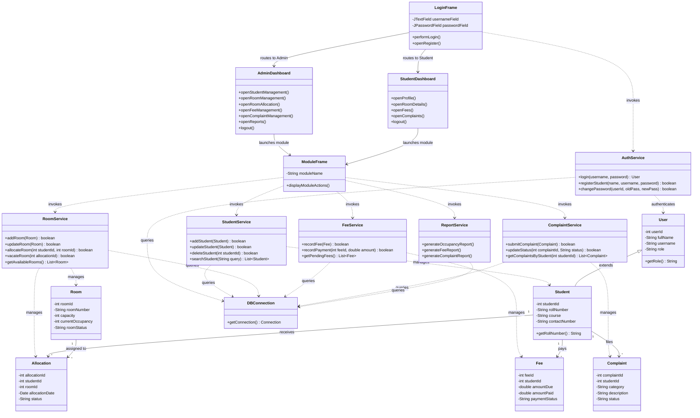

# 🏢 Student Hostel Management System (SHMS)

[](https://www.oracle.com/java/)
[](https://www.mysql.com/)
[]()
[]()
[]()

> A robust, role-based Java application designed to digitize, streamline, and secure hostel operations—including room allocations, student records, fee tracking, grievance handling, and automated reporting.

---

## 📌 Table of Contents
1. [Project Overview](#-project-overview)
2. [Problem Statement](#-problem-statement)
3. [Expected Outcomes](#-expected-outcomes)
4. [Alignment with UN Sustainable Development Goals (SDGs)](#-alignment-with-un-sustainable-development-goals-sdgs)
5. [Course Syllabus Alignment](#-course-syllabus-alignment)
6. [3-Phase Development Roadmap](#-3-phase-development-roadmap)
7. [What Has Been Implemented (Phase 1 Status)](#-what-has-been-implemented-phase-1-status)
8. [System Architecture & Visual Diagrams](#-system-architecture--visual-diagrams)
   - [Diagram 1: Functional Decomposition Diagram (FDD)](#diagram-1-functional-decomposition-diagram-fdd)
   - [Diagram 2: UML Class Diagram](#diagram-2-uml-class-diagram)
   - [Diagram 3: Entity-Relationship (ER) Diagram](#diagram-3-entity-relationship-er-diagram)
9. [Project Directory & Package Structure](#-project-directory--package-structure)
10. [Technologies & Tools Used](#-technologies--tools-used)
11. [Installation & Setup Guide](#-installation--setup-guide)
12. [Usage & Workflow](#-usage--workflow)
13. [Contributors & Acknowledgments](#-contributors--acknowledgments)

---

## 📖 Project Overview

The **Student Hostel Management System (SHMS)** is an end-to-end management solution developed to replace inefficient, paper-heavy, and error-prone hostel administration workflows. Built using core and advanced Java methodologies, the system provides separate, secure, role-based dashboards for **Hostel Wardens/Administrators** and **Hostel Residents (Students)**.

By centralizing data management and enforcing strict cryptographic security, SHMS ensures seamless room allocations, real-time tracking of room occupancy, transparent fee recording, structured grievance registration, and comprehensive administrative reporting.

---

## ❗ Problem Statement

Hostels in educational institutions frequently face administrative bottlenecks due to traditional record-keeping:
- **Manual Logbooks & Registers:** Student personal details, room allocations, and vacancy states are maintained in physical registers, leading to data loss, unauthorized access, and wear-and-tear.
- **Unoptimized Room Allocations:** Administrative staff struggle with room capacity management, duplicate bed assignments, and tracking vacant slots.
- **Opaque Fee Management:** Tracking pending dues, payment dates, and receipts via paper files often leads to accounting discrepancies and delayed audits.
- **Unresponsive Grievance Redressal:** Maintenance and facility complaints submitted verbally or in note slips often go untracked and unresolved.
- **Lack of Role-Based Security:** Sensitive student personal data is accessible to unauthorized personnel due to a lack of digital access controls and secure authentication.

**The Solution:** A secure, modular, 3-tier software architecture engineered in Java that establishes centralized digital records, authenticated role-based access control (RBAC), and automated workflow pipelines.

---

## 🎯 Expected Outcomes

- **Centralized Student & Hostel Records:** Eliminates physical registers with a single persistent MySQL database.
- **Efficient Room Allocation & Occupancy Management:** Real-time visibility into occupied, partially occupied, and vacant rooms with one-click bed allotment.
- **Role-Based Access & High-Grade Security:** Clear isolation between administrative privileges and student self-service functionalities, backed by salted PBKDF2 password cryptography.
- **Transparent Fee & Complaint Tracking:** Real-time fee clearance indicators, automated receipt logging, and a systematic status lifecycle for student complaints (Pending ➔ In Progress ➔ Resolved).
- **Automated Hostel Reports:** Instant generation of reports for audit inspections, occupancy status, student demographics, and pending dues.

---

## 🌐 Alignment with UN Sustainable Development Goals (SDGs)

This project directly contributes to the United Nations Sustainable Development Goals:

| Goal | Description & Project Alignment |
| :--- | :--- |
| **SDG 9: Industry, Innovation, and Infrastructure** | **Digitizing Infrastructure & Resilient Systems:** By transitioning manual legacy operations into an automated, secure Java database application, SHMS exemplifies modern technological infrastructure for academic institutions. It integrates enterprise security standards (PBKDF2 key derivation, modular architecture) to ensure digital reliability. |
| **SDG 16: Peace, Justice, and Strong Institutions** | **Transparency, Accountability & Fair Redressal:** Eliminates nepotism and human error in room allocation and fee accounting through immutable digital records. Introduces an accountable, timestamped complaint resolution mechanism that empowers students and holds hostel management accountable. |

---

## 🎓 Course Syllabus Alignment

The implementation of this project is structured to strictly reflect and apply each section of the **Advanced Java / Object-Oriented Software Development** university syllabus:

```
┌─────────────────────────────────────────────────────────────────────────────────────────────┐
│                               COURSE SYLLABUS MAPPING                                       │
├─────────────────────┬─────────────────────────────────┬─────────────────────────────────────┤
│ Syllabus Section    │ Core Concepts Covered           │ Project Implementation Details      │
├─────────────────────┼─────────────────────────────────┼─────────────────────────────────────┤
│ Section-A:          │ • OOP Principles                │ • Encapsulation in Model layer      │
│ Core Java &         │   (Encapsulation, Inheritance,  │   (`User`, `Student`, `Room`)       │
│ Collection          │   Polymorphism, Abstraction)    │ • In-memory caching and session     │
│ Framework           │ • Collections: List, Map, Set   │   state via `Session` singleton     │
│                     │ • Iterators & Enumeration       │ • Dynamic data feeds for UI lists   │
├─────────────────────┼─────────────────────────────────┼─────────────────────────────────────┤
│ Section-B:          │ • Swing Containers & Frames     │ • Custom GUI frames (`LoginFrame`,  │
│ GUI Development     │ • Layout Managers               │   `AdminDashboard`, `ModuleFrame`)  │
│                     │   (Border, GridBag, Grid)       │ • Delegation Event Model with       │
│                     │ • Swing Components & Dialogs    │   `ActionListener`, lambda handlers │
│                     │ • Event Dispatch Thread (EDT)   │ • `SwingUtilities.invokeLater()`    │
├─────────────────────┼─────────────────────────────────┼─────────────────────────────────────┤
│ Section-C:          │ • `java.sql` Architecture       │ • Persistent connection via         │
│ Database            │ • PreparedStatement & ResultSet │   `DBConnection` & JDBC MySQL Driver│
│ Connectivity &      │ • SQL Exception Handling        │ • SQL Injection prevention via      │
│ Networking          │ • Cryptographic Hashing         │   parameterized queries             │
│                     │ • Client-Server Networking      │ • Phase 2/3 socket & network audits │
├─────────────────────┼─────────────────────────────────┼─────────────────────────────────────┤
│ Section-D:          │ • Java Servlets (Lifecycle,     │ • Complete Phase 3 Web migration    │
│ Web Development,    │   HttpServletRequest/Response)  │ • Model-View-Controller (MVC)       │
│ JSP & Frameworks    │ • JSP Directives, Actions, JSTL │ • Session management across web     │
│                     │ • Spring Boot / Hibernate       │ • Hibernate ORM entity mappings     │
└─────────────────────┴─────────────────────────────────┴─────────────────────────────────────┘
```

---

## 🚀 3-Phase Development Roadmap

The project is executed across three planned phases to achieve enterprise scalability:

```
┌─────────────────────────────────────────────────────────────────────────────────────────┐
│                                  PROJECT ROADMAP                                        │
└─────────────────────────────────────────────────────────────────────────────────────────┘
        │
        ├───► [PHASE 1] Core Authentication & Foundation (COMPLETED ✅)
        │     • MySQL Database & User Schema initialization
        │     • Industrial PBKDF2 password hashing & verification
        │     • Interactive Swing GUI with Event Delegation Model
        │     • Dynamic Role-Based Routing (Admin vs. Student)
        │     • Navigation wireframes matching Functional Decomposition Diagram
        │
        ├───► [PHASE 2] Full Desktop Business Logic & Data CRUD (COMPLETED ✅)
        │     • Multi-entity relational schema (Students, Rooms, Allocations, Fees, Complaints)
        │     • Data Access Object (DAO) layer implementation with transactional integrity
        │     • Interactive `JTable` views with search, sort, and filter features
        │     • Transactional workflows: Room Allocation, Fee Receipts, Complaint Updates
        │     • Automated analytical hostel reports (Demographics, Occupancy, Fees, Complaints)
        │
        └───► [PHASE 3] Enterprise Web Application Migration (FINAL PHASE 🌐)
              • Migration from Desktop Swing to Web MVC Architecture
              • Servlets, JSP, and JSTL implementation for web browsers
              • HTTP Session tracking and Web Security Filters
              • Spring Boot & Hibernate ORM integration for RESTful scalability
```

---

## ✅ What Has Been Implemented (Phase 1 Status)

As of **Phase 1**, the complete foundational framework has been engineered and verified:

1. **Database Connection Management (`DBConnection.java`):**
   - Implements a resilient connection factory using `java.sql.DriverManager`.
   - Targets local MySQL instance (`jdbc:mysql://localhost:3306/hostel_db`).
   - Handles connection exceptions cleanly.

2. **Enterprise-Grade Password Cryptography (`PasswordUtil.java`):**
   - Utilizes `PBKDF2WithHmacSHA256` key derivation.
   - Configured with **600,000 iterations**, a **256-bit derived key length**, and **16-byte cryptographically secure random salts** (`SecureRandom`).
   - Secure storage format (`<Base64 Salt>:<Base64 Hash>`) with constant-time equality checks (`MessageDigest.isEqual`) to eliminate timing-attack vulnerabilities.

3. **Autonomous Admin Bootstrapping CLI (`AdminSetup.java`):**
   - One-time secure command-line provisioning script for the initial administrative account.
   - Enforces strict password complexity (minimum 12 characters) and username format verification.
   - Guards against multiple admin initialization.

4. **Student Self-Registration Interface (`RegisterFrame.java`):**
   - User-friendly GUI with real-time field validation, password matching, and sanitization.
   - Automated detection and graceful handling of duplicate usernames (MySQL error code `1062` / SQLState `23000`).
   - Memory-safe credential handling using `char[]` clearing.

5. **Role-Based Authentication Engine (`LoginFrame.java` & `AuthService.java`):**
   - Authenticates credentials against the active user database.
   - Dynamically routes users based on their authorized role:
     - `ADMIN` ➔ Redirects to `AdminDashboard`
     - `STUDENT` ➔ Redirects to `StudentDashboard`

6. **State & Session Management (`Session.java` & `User.java`):**
   - Thread-safe in-memory session tracking for currently logged-in user details.
   - Complete session termination and memory flush on logout.

7. **Modular UI Skeleton (`AdminDashboard`, `StudentDashboard`, `ModuleFrame`, `UIUtils`):**
   - Intuitive Swing interfaces built with clean borders, cohesive color accents, and standard fonts.
   - Dynamic top banners displaying personalized user greetings (`Logged in as: <Name>`).
   - 100% synchronized with the **Functional Decomposition Diagram (FDD)**.

8. **Self-Service Password Management (`ChangePasswordDialog.java` & `AuthService.changePassword`):**
   - Completes the third branch of Authentication from the FDD (`Login`, `Logout`, `Change Password`).
   - Enforces password confirmation, old-password re-verification against stored PBKDF2 hash, and role-appropriate character length requirements.

---

## 🚀 What Has Been Implemented (Phase 2 Status)

In **Phase 2**, the complete desktop application and relational database operations have been fully engineered:

1. **Relational Database Expansion (`phase2_schema.sql`):**
   - Implemented 5 relational tables (`students`, `rooms`, `allocations`, `fees`, `complaints`) with foreign key constraints, cascading deletions, and data integrity guarantees.
   - Seeded initial room configurations and sample accommodation records.

2. **Enterprise Data Access Object (DAO) Architecture:**
   - **`StudentDAO.java`**: Full student CRUD operations, multi-parameter search, and transactional user-student profile creation.
   - **`RoomDAO.java`**: Capacity tracking, available vs. occupied room querying, and safe room deletion guards.
   - **`AllocationDAO.java`**: Transactional room allotment, room transfer/change, and vacation logic that automatically updates live bed occupancy.
   - **`FeeDAO.java`**: Invoice generation, payment recording, balance calculations, and payment status transitions (`PENDING` ➔ `PAID`).
   - **`ComplaintDAO.java`**: Grievance registration, warden status tracking (`PENDING` ➔ `IN_PROGRESS` ➔ `RESOLVED`), and resolution remark logging.
   - **`ReportDAO.java`**: Multi-dimensional analytical querying for student demographics, room occupancy metrics, fee audits, and grievance summaries.

3. **Interactive Admin Control Panels:**
   - **`StudentManagementFrame.java`**: Real-time student search, tabular records, add/edit modal dialogues, and safe deletions.
   - **`RoomManagementFrame.java`**: Room inventory filtering (All / Available / Occupied), room addition, and capacity updates.
   - **`RoomAllocationFrame.java`**: Streamlined allotment dialog with auto-filtered unallocated students and vacant rooms, room transfer, and vacation handlers.
   - **`FeeManagementFrame.java`**: Invoice generation, partial/full payment recording with receipt reference tracking.
   - **`ComplaintManagementFrame.java`**: Complaint inbox for hostel wardens with live status updating and remark entry.
   - **`ReportsFrame.java`**: Tabbed analytics center rendering Student Demographics, Room Occupancy rates, Fee Auditing, and Complaint Redressal reports.

4. **Dedicated Student Resident Self-Service:**
   - **`StudentProfileFrame.java`**: View personal academic records and update contact/emergency phone numbers and address.
   - **`StudentRoomFrame.java`**: Real-time view of allocated room number, block, capacity, current roommates, and monthly fee.
   - **`StudentFeesFrame.java`**: Live status of fee invoices, payment receipts, and outstanding dues.
   - **`StudentComplaintsFrame.java`**: Form to submit maintenance grievances with category tags and track resolution statuses.

---

## 📊 System Architecture & Visual Diagrams

### Diagram 1: Functional Decomposition Diagram (FDD)
*Represents the hierarchical breakdown of the system functions and role-based permissions.*

```mermaid
graph TD
    Root["Student Hostel Management System"]
    
    Auth["Authentication"]
    Admin["Admin / Warden Dashboard<br/>(Full Access)"]
    Student["Student Dashboard<br/>(Own Data Only)"]
    
    Root --> Auth
    Root --> Admin
    Root --> Student
    
    %% Auth Functions
    Auth --> F_Login["Login"]
    Auth --> F_Logout["Logout"]
    Auth --> F_CPass["Change Password"]
    
    %% Admin Modules
    Admin --> M_SM["Student Management"]
    Admin --> M_RM["Room Management"]
    Admin --> M_RA["Room Allocation"]
    Admin --> M_FM["Fee Management"]
    Admin --> M_CM["Complaint Management"]
    Admin --> M_REP["Reports"]
    
    %% Admin Functions
    M_SM --> F_AddS["Add Student"]
    M_SM --> F_ViewS["View Student"]
    M_SM --> F_SearchS["Search Student"]
    M_SM --> F_UpdS["Update Student"]
    M_SM --> F_DelS["Delete Student"]
    
    M_RM --> F_ViewR["View Room"]
    M_RM --> F_AddR["Add Room"]
    M_RM --> F_UpdR["Update Room"]
    M_RM --> F_DelR["Delete Room"]
    M_RM --> F_AvailR["View Available Rooms"]
    M_RM --> F_OccR["View Occupied Rooms"]
    
    M_RA --> F_AllocR["Allocate Room"]
    M_RA --> F_ChgR["Change Room"]
    M_RA --> F_VacR["Vacate Room"]
    M_RA --> F_ViewAlloc["View Allocation"]
    
    M_FM --> F_RecFee["Record Fee"]
    M_FM --> F_ViewFee["View Fee"]
    M_FM --> F_PendFee["View Pending Fees"]
    M_FM --> F_RecPay["Record Payment"]
    M_FM --> F_UpdPay["Update Payment Status"]
    
    M_CM --> F_ViewC["View Complaints"]
    M_CM --> F_ViewCDet["View Complaint Details"]
    M_CM --> F_UpdCStat["Update Status"]
    M_CM --> F_ResC["Resolve Complaint"]
    
    M_REP --> F_SReport["Student Report"]
    M_REP --> F_RReport["Room Report"]
    M_REP --> F_FReport["Fee Report"]
    M_REP --> F_OReport["Occupancy Report"]
    M_REP --> F_CReport["Complaint Report"]
    
    %% Student Modules & Functions
    Student --> M_SProf["Profile"]
    Student --> M_SRoom["Room Details"]
    Student --> M_SFees["Fees"]
    Student --> M_SComp["My Complaints"]
    
    M_SProf --> F_SViewP["View Profile"]
    M_SProf --> F_SUpdP["Update Profile"]
    
    M_SRoom --> F_SViewR["View Allocated Room"]
    
    M_SFees --> F_SViewFee["View Fee Details"]
    M_SFees --> F_SViewPStat["View Payment Status"]
    
    M_SComp --> F_SSubC["Submit Complaint"]
    M_SComp --> F_SViewMC["View My Complaints"]
```



---

### Diagram 2: UML Class Diagram
*A comprehensive, hierarchical 3-tier UML Class Diagram covering all functional modules (Students, Rooms, Allocations, Fees, Complaints, Reports, and Security) structured top-to-bottom without visual clutter.*



---

### Diagram 3: Entity-Relationship (ER) Diagram
*Depicts the database schema, including the implemented `users` table and Phase 2 relational extensions.*


---

## 📁 Project Directory & Package Structure

```
studentHostelManagementSystem/
│
├── .classpath                          # Eclipse IDE classpath configuration
├── .project                            # Eclipse project metadata
├── .settings/                          # IDE project settings
├── README.md                           # Comprehensive project documentation
│
├── MySQL Database/                     # Database Definition & SQL Scripts
│   ├── users.sql                       # Phase 1 DDL: Database & Authentication Table
│   └── phase2_schema.sql               # Phase 2 DDL: Students, Rooms, Allocations, Fees, Complaints
│
├── src/                                # Java Source Code
│   │
│   ├── module-info.java                # Java Module System Descriptor (`java.desktop`, `java.sql`)
│   │
│   └── com/hostelmanagement/
│       ├── Main.java                   # Application Entrypoint (Launches Swing EDT)
│       │
│       ├── auth/                       # Security & Authentication Layer
│       │   ├── AdminSetup.java         # CLI Utility to bootstrap initial Administrator
│       │   ├── AuthService.java        # Authentication business logic & SQL executions
│       │   └── PasswordUtil.java       # Industrial PBKDF2-HMAC-SHA256 password security
│       │
│       ├── dao/                        # Data Access Object (DAO) Persistence Layer
│       │   ├── AllocationDAO.java      # Room allocation, transfer, and vacate operations
│       │   ├── ComplaintDAO.java       # Student grievance filing and status updates
│       │   ├── FeeDAO.java             # Fee billing, payment tracking, and receipt logs
│       │   ├── ReportDAO.java          # Analytics, statistics, and audit report generation
│       │   ├── RoomDAO.java            # Room inventory, capacity, and status queries
│       │   └── StudentDAO.java         # Student profiles, CRUD, and search filters
│       │
│       ├── database/                   # Database Connectivity Layer
│       │   └── DBConnection.java       # JDBC Connection Factory for MySQL
│       │
│       ├── model/                      # Data Transfer Objects & Domain Models
│       │   ├── Allocation.java         # Room allotment entity
│       │   ├── Complaint.java          # Maintenance request entity
│       │   ├── Fee.java                # Fee invoice and payment transaction entity
│       │   ├── Room.java               # Hostel room and bed capacity entity
│       │   ├── Student.java            # Student resident profile entity
│       │   └── User.java               # Immutable representation of an authenticated user
│       │
│       ├── session/                    # In-Memory Session Management
│       │   └── Session.java            # Thread-safe user session context holder
│       │
│       ├── ui/                         # Presentation Layer (Java Swing GUI)
│       │   ├── AdminDashboard.java     # Warden & Admin control panel
│       │   ├── ChangePasswordDialog.java # Self-service password update modal
│       │   ├── ComplaintManagementFrame.java # Admin complaint resolution dashboard
│       │   ├── FeeManagementFrame.java # Admin fee invoice and payment tracker
│       │   ├── LoginFrame.java         # User login screen with role redirection
│       │   ├── ModuleFrame.java        # Modular container for sub-functional workflows
│       │   ├── RegisterFrame.java      # Student self-registration window
│       │   ├── ReportsFrame.java       # Tabbed administrative reporting center
│       │   ├── RoomAllocationFrame.java# Bed allotment, transfer, and vacate console
│       │   ├── RoomManagementFrame.java# Room inventory and capacity management
│       │   ├── StudentComplaintsFrame.java # Student grievance submission and tracking
│       │   ├── StudentDashboard.java   # Student resident self-service dashboard
│       │   ├── StudentFeesFrame.java   # Student fee dues and payment receipts view
│       │   ├── StudentManagementFrame.java # Admin student directory and CRUD console
│       │   ├── StudentProfileFrame.java# Student profile view and contact updater
│       │   └── StudentRoomFrame.java   # Student allocated room and roommate details
│       │
│       └── util/                       # Reusable UI & Application Utilities
│           └── UIUtils.java            # Standardized button styling, table renderer, dialogs
│
└── bin/                                # Compiled Bytecode (.class files)
```

---

## 🛠 Technologies & Tools Used

- **Programming Language:** Java 21 (LTS)
- **Graphical User Interface (GUI):** Java Swing & AWT (`BorderLayout`, `GridBagLayout`, `GridLayout`)
- **Database:** MySQL 8.0+
- **Database Driver:** MySQL Connector/J (`mysql-connector-j-9.x.jar`)
- **Cryptography / Hashing:** `PBKDF2WithHmacSHA256` (Java Cryptography Extension)
- **Build / IDE:** Eclipse IDE / Antigravity CLI / Visual Studio Code
- **Version Control:** Git & GitHub

---

## ⚙️ Installation & Setup Guide

### 1. Prerequisites
- **Java Development Kit (JDK 21 or higher)** installed and added to your system `PATH`.
- **MySQL Server (v8.0 or higher)** installed and running.
- **MySQL Connector/J JAR** placed in the project classpath.

---

### 2. Database Initialization
1. Open MySQL Command Line Client or MySQL Workbench:
   ```bash
   mysql -u root -p
   ```
2. Execute the script located in `MySQL Database/users.sql`:
   ```sql
   CREATE DATABASE IF NOT EXISTS hostel_db;
   USE hostel_db;

   CREATE TABLE IF NOT EXISTS users (
       user_id INT PRIMARY KEY AUTO_INCREMENT,
       full_name VARCHAR(100) NOT NULL,
       username VARCHAR(50) NOT NULL UNIQUE,
       password_hash VARCHAR(255) NOT NULL,
       role ENUM('ADMIN', 'STUDENT') NOT NULL,
       is_active BOOLEAN NOT NULL DEFAULT TRUE,
       created_at TIMESTAMP DEFAULT CURRENT_TIMESTAMP
   );
   ```

---

### 3. Database Credentials Configuration
Open [DBConnection.java](file:///c:/Harshit/mruLABS/studentHostelManagementSystem/src/com/hostelmanagement/database/DBConnection.java) and verify your local MySQL credentials:
```java
private static final String URL = "jdbc:mysql://localhost:3306/hostel_db";
private static final String DB_USER = "root";
private static final String DB_PASSWORD = "your_mysql_password"; // Set your password
```

---

### 4. Create the First Admin Account
Before launching the graphical application, create the root Administrator account using the command-line utility:

- Run `com.hostelmanagement.auth.AdminSetup`:
  ```bash
  # Inside your IDE: Right click AdminSetup.java -> Run As -> Java Application
  ```
- Follow the interactive prompts:
  ```text
  Admin full name: Chief Warden
  Admin username: admin
  Admin password (minimum 12 characters): AdminPass@1234
  >> Admin account created successfully.
  ```

---

### 5. Launch the Application
Run the primary entry point:
- Execute `com.hostelmanagement.Main`
- The `LoginFrame` will appear on screen.

---

## 🖥 Usage & Workflow

### 1. Student Registration
- Click **"Register as Student"** on the Login screen.
- Fill in Full Name, Username, and Password (min 8 chars).
- Submit the form. On success, log in with the new credentials.

### 2. Role-Based Navigation
- **Logging in as Student:**
  - Routes directly to `StudentDashboard`.
  - Access personal Profile, View Room Details, Check Fee Status, and Submit Complaints.
- **Logging in as Admin / Warden:**
  - Routes directly to `AdminDashboard`.
  - Access comprehensive administrative controls: Student records, Room creation & allocation, Fee tracking, Complaint resolution, and Master Reports.

### 3. Logout
- Click the **"Logout"** button on the top-right of either dashboard to securely clear the current session and return to the Login screen.

---

## 🔮 What's Next? (Phase 2 & Phase 3 Roadmap)

| Module | Phase 2 Scope (Desktop CRUD & DAOs) | Phase 3 Scope (Web App & Servlets/JSP) |
| :--- | :--- | :--- |
| **Student Management** | Add/Edit/Delete students, dynamic table view with filter by course/batch. | Responsive web forms, REST API for student profiles. |
| **Room Allocation** | Interactive room occupancy matrix, one-click bed assignment. | Web-based room selection portal for prospective students. |
| **Fee Management** | Receipt generation, overdue fee alerts, record direct payments. | Online payment gateway integration, downloadable PDF receipts. |
| **Complaints** | Real-time complaint inbox for wardens with status toggle. | Ticket-tracking web dashboard with student notification emails. |
| **Reports** | Printable tabular reports exported as CSV/PDF. | Dynamic web analytics dashboard with charting libraries. |

---

## 👥 Contributors & Acknowledgments

- **Developed By:** Harshit Singhal
- **Academic Program:** Bachelor of Technology (Computer Science & Engineering) / Advanced Java Lab
- **Course Alignment:** Advanced Java Programming (Core OOPS, Swing GUI, JDBC & Sockets, Servlets & JSP)
